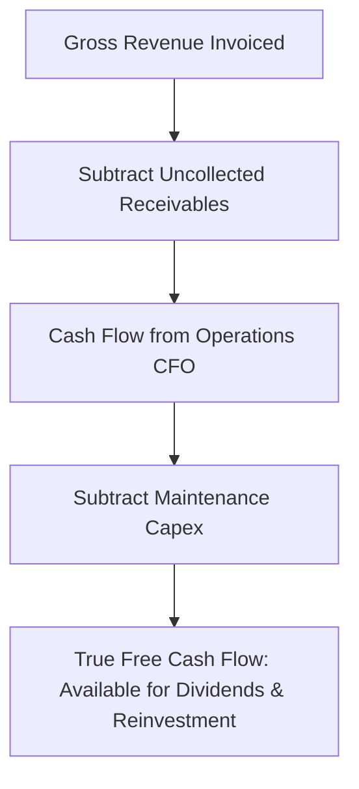

## 1. Accounting Profit vs Economic Cash Flow

One of the most frequent errors made by individual equity investors is focusing strictly on published **Earnings Per Share (EPS)** or **Price-to-Earnings (P/E)** ratios.

Under Indian Accounting Standards (Ind AS), revenue is recognized when invoices are generated, not when cash is received. A manufacturing company can report robust top-line growth and surging net profits while simultaneously heading toward insolvency because customer cash is locked in delayed receivables and inventory accumulation.

The ultimate measure of corporate profitability is **Owner's Free Cash Flow (FCF)**:

$$
FCF = \text{Operating Cash Flow (CFO)} - \text{Maintenance Capital Expenditure (Capex)}
$$

---

## 2. The Core Compounding Engine: Return on Capital Employed (ROCE)

No company can compound investor wealth over decades if its underlying return on capital is inferior:

$$
ROCE = \frac{\text{Earnings Before Interest and Taxes (EBIT)}}{Total Assets - Current Liabilities}
$$

### Why ROCE Governs Long-Term Equity Compounding:
As Charlie Munger famously demonstrated:
> *"Over the long term, it's hard for a stock to earn a much better return than the business which underlies it earns. If the business earns 6% on capital over 40 years, you're not going to make much different than a 6% return—even if you originally buy it at a huge discount. Conversely, if a business earns 25% on capital over 30 or 40 years, even if you pay an expensive looking price, you'll end up with one hell of a result."*

| Corporate Archetype | Sustainable ROCE | Reinvestment Runway | 15-Year Typical Compounding Outcome |
| :--- | :--- | :--- | :--- |
| **Monopolistic Consumer / Tech** | **$35\% - 55\%$** | High (Expands into adjacent markets) | **High Multi-Bagger ($18\% - 24\%$ CAGR)** |
| **Capital-Intensive Commodity / Infra** | $8\% - 12\%$ | High (Must constantly rebuild plant) | Underperforms Fixed Income post-tax |
| **Highly Leveraged Cyclical** | Volatile ($-5\%  to  +20\%$) | Low | High bankruptcy risk during downturns |

---

## 3. Historical Nifty 50 P/E Multiples and Forward Returns

Historical empirical analysis of the **Nifty 50 trailing Price-to-Earnings ratio** (using consolidated earnings datasets from 2000 to 2025) proves the undeniable reality of **valuation mean reversion**:

| Entry Trailing P/E Range | Market Valuation Regime | Historical 3-Year Forward CAGR | Probability of Positive 3-Year Return |
| :--- | :--- | :--- | :--- |
| **Below 15.0x** | Deep Value Panic (2002, 2008, 2020) | **$+22.5\%  to  +35.0\%$** | **$100.0\%$** |
| **15.0x – 20.0x** | Fair / Average Historical Valuation | **$+12.0\%  to  +16.0\%$** | **$91.5\%$** |
| **20.0x – 24.0x** | Fully Valued | $+7.5\%  to  +11.0\%$ | $78.0\%$ |
| **Above 25.0x** | Euphoric Speculation (2000, 2007, 2021) | **$-2.0\%  to  +5.2\%$** | **$< 48.0\%$** |

Entering the broader equity market at euphoric multiples ($>25x$) virtually guarantees that forward 3 to 5-year returns will be subdued as corporate earnings catch up to stretched stock prices.
