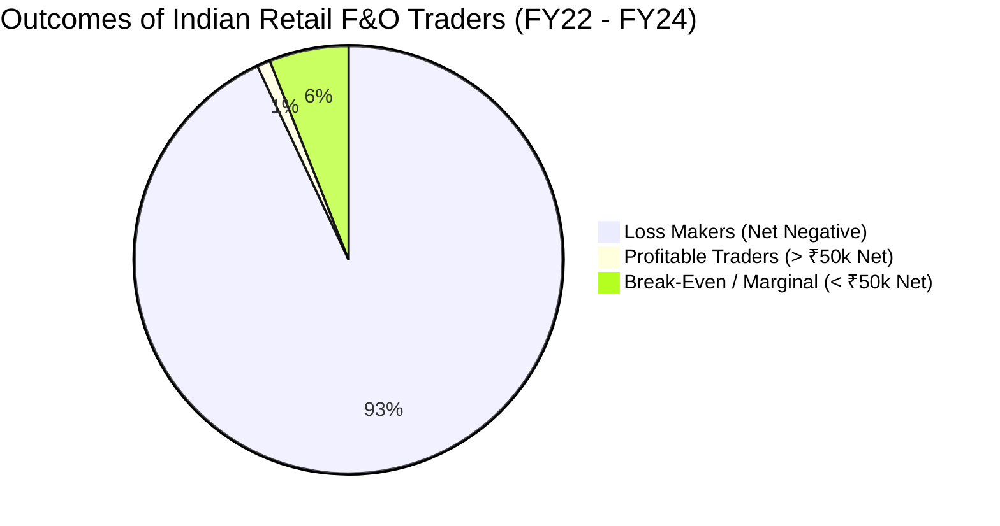
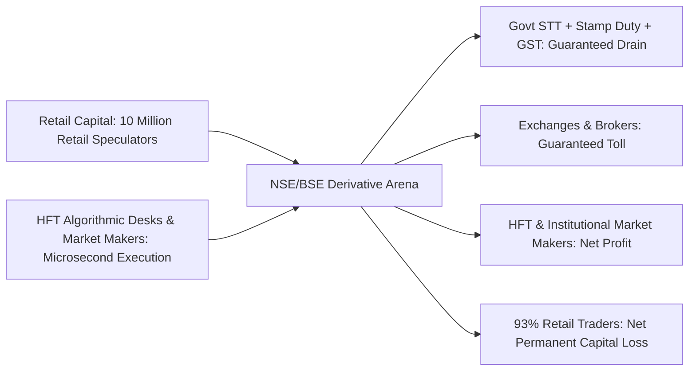

## 1. The Alarming Data: SEBI's September 2024 Forensic Report

In September 2024, the Securities and Exchange Board of India (SEBI) published an updated comprehensive study tracking **over 1 Crore (10 Million) individual retail traders** active in the equity Futures & Options segment across FY22, FY23, and FY24.

The statistical findings were devastating:

### Key Quantitative Findings from SEBI's Official Audit:
1. **$93.0\%$ of all individual retail traders** incurred net trading losses across the 3-year observation window.
2. The **average net financial loss was approximately ₹2,00,000 (₹2 Lakhs) per trader**, excluding friction costs.
3. **Transaction Costs Extortion:** For every ₹100 lost in pure trading losses, retail traders paid an **additional ₹28 in non-recoverable transaction charges** (Securities Transaction Tax - STT, exchange turnover fees, GST, SEBI turnover fees, and broker commissions).
4. **Top Outliers:** Less than **$1.0\%$ of active retail traders** earned more than ₹1,00,000 net profit after deducting transaction costs!

---

## 2. Why Derivatives Are a Negative-Sum Game for Retail

In secondary equity markets (buying shares of Infosys or Tata Motors), the market is a **positive-sum game**: corporations innovate, sell goods, generate profits, and distribute cash dividends. Over decades, the entire market value expands.

In the derivatives market, **every contract has an exact buyer and an exact seller**:

$$
\sum Gross Trading Profits + \sum Gross Trading Losses = 0 \implies \text{Zero-Sum Game}
$$

When statutory government taxes and financial intermediary fees are subtracted:

$$
\sum Net Trading Outcomes = -\left(STT + Exchange Fees + Brokerage + GST + Stamp Duty\right) < 0
$$

The derivatives market is **strictly a negative-sum game**. Millions of Rupees are drained from the market every trading session directly into the government exchequer and exchange coffers.

---

## 3. The Theta Time-Decay Trap: Why Option Buyers Perish

Over $85\%$ of retail derivative activity in India consists of **buying Out-of-the-Money (OTM) Call and Put options** on the Nifty and Bank Nifty indices (often called "Hero-or-Zero" expiry day trades).

Retail buyers love OTM options because they are cheap (₹10 to ₹50 per lot), providing the illusion of low risk and massive leverage.

In quantitative options pricing (the Black-Scholes-Merton model), the price of an option ($V$) decays exponentially as expiration approaches:

$$
\Theta = \frac{\partial V}{\partial t} < 0
$$

Every second that Dalal Street does not experience a massive, violent market trend, **Theta time-decay silently bleeds the premium to zero**. Professional institutional algorithmic market makers systematically collect this decay by selling premium, while retail option buyers repeatedly watch their options expire worthless.
